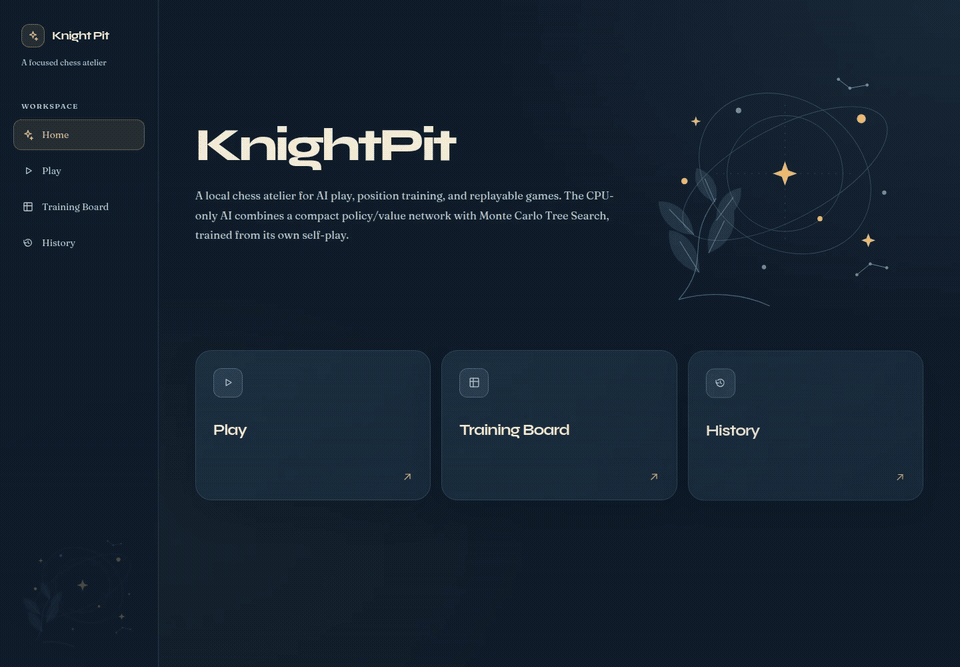

# KnightPit

KnightPit is an offline-first chess application for Android and the browser, built with React/TypeScript and a bundled Stockfish 19.0.1 WebAssembly worker. The original CPU-only Python AI remains a separate, reproducible research project in `KnightPitAI/`; it no longer controls application games.

## See it in action

[](media/knightpit-demo.mp4)

**[Download the full-resolution video (MP4, 31 seconds, no audio)](media/knightpit-demo.mp4)**

The demo shows the redesigned home, time-control selection, a live game against the AI, move-by-move replay with recorded clock times, and a custom FEN training position ending in checkmate. The animated preview plays directly in the README. Recorded from the running production build with the untrained `development-seed-42` model: this demonstrates the interface, not playing strength.

Current Play uses the unmodified Stockfish.js **lite single-thread** build with embedded NNUE: one worker, a 16 MiB hash table and clock-aware thinking capped at 1.2 seconds per move. No Python, backend, runtime download, account, SharedArrayBuffer or cross-origin isolation is required. KnightPit's own rules validate every returned move. Reset, navigation and backgrounding cancel work; obsolete responses cannot move a new game. No device-specific Elo rating is claimed.

## Features

- Play against bundled Stockfish on Android or in a modern browser.
- Review completed games with each mover's remaining clock time after increment; older games without recorded times show `—`.
- Project-owned chess rules with legal-move validation, castling, en passant, promotion, checkmate, stalemate, and draw handling.
- CPU-only self-play, replay generation, training, evaluation, checkpoint inspection, and resumable campaigns.
- Filled white/black Cburnett SVG pieces, independent of system chess fonts.
- Portfolio-style swipe-to-open Android entry in KnightPit's navy, gold and mineral palette.
- Single-screen mobile gameplay: board, clocks, actions and internally scrolling move history; landscape uses side-by-side controls.
- Separate Python research tools: CPU self-play, training, evaluation and local FastAPI inference.

## Technology

- **Frontend:** React, TypeScript, React Router, Motion, Tailwind CSS, and Vite.
- **Visual identity:** blue ink, warm ivory, amber and icy blue; self-hosted Syne headings and HanPit's system sans-serif reading stack, rounded panels, and non-interactive orbital/botanical ornaments. The interface continues the portfolio and QuantaPit design language without changing application copy or chess rules.
  The home star has three bodies orbiting along its visible SVG tracks at different speeds. Only the home ornament is animated; the sidebar decoration stays static, and reduced-motion preferences show stationary bodies on those tracks.
- **Android:** Capacitor 8.5.3, native system/cutout/keyboard insets, stable app-private `https://localhost` origin.
- **Research:** Python 3.10–3.13, NumPy, FastAPI, Uvicorn and pytest.

## Repository layout

```text
src/                       React application and chess UI
KnightPitAI/src/           Python chess environment, model, MCTS, training, and API
KnightPitAI/tests/         Backend and AI tests
android/                   Native Android application and release signing config
public/engine/             Stockfish binaries, corresponding source, network and GPL
public/pieces/cburnett/    Filled SVG sources, license and attribution
scripts/dev.mjs            Optional research API launcher (dev:research)
scripts/engine-smoke.mjs   Real-WASM legal play, forced mate and cancellation checks
.github/workflows/         Continuous integration
```
## Install Android

**[Download KnightPit-Android.apk](https://github.com/ManfuG/KnightPit/releases/latest/download/KnightPit-Android.apk)**

Open the APK on Android and allow installation from your browser/file manager when prompted. Requires **Android 8/API 26+** and **System WebView 119+**. All chess engine, font, piece, artwork, source and license files are bundled: first launch and play work in airplane mode. Swipe upward or activate the arrow to enter; the opening appears once per app document, not on ordinary resume.

Completed games stay on the device. Browser and Android storage are separate; uninstalling/clearing app data removes local history. Android backup/device transfer are disabled. No unfinished-game persistence or cloud synchronization is added. Install same-key updates over the existing app to retain completed history.

## Run the browser app

Requires Node.js **22.22.2+**, **24.15+**, or **26+**, following `package.json`/`.nvmrc`. Install dependencies once:

```sh
npm ci
npm run dev
```

Open **http://localhost:5173**, select Play and Start game. Ctrl+C stops Vite. Python/checkpoints are not needed. `npm run build` produces `dist/`; serve it with `npm run preview` or any static server. Assets honor Vite's base path for embedded deployments. A static website needs its files available/cached to load; Android guarantees bundled offline startup without a service worker.

Older `VITE_AI_URL` / `VITE_AI_MODE` settings no longer configure application play. This source update does not deploy the hosted portfolio.

## Build Android

Use JDK **21**, Android SDK **36**, build-tools **36.0.0**, and set `ANDROID_HOME` or ignored `android/local.properties`. The Gradle wrapper is included.

```sh
npm ci
npm run android:sync
cd android
./gradlew assembleDebug
```

For a signed release, set `KNIGHTPIT_KEYSTORE_PATH`, `KNIGHTPIT_KEYSTORE_PASSWORD`, `KNIGHTPIT_KEY_ALIAS` and `KNIGHTPIT_KEY_PASSWORD`, then run `npm run android:build` from the repository root. Release signing fails if any value is missing. Never commit a private key, password or local SDK path; preserve the release key for future upgrades.

The `v<package-version>` release workflow publishes the signed `KnightPit-Android.apk`, SHA-256 checksum and public signing-certificate details. GitHub secrets: `KNIGHTPIT_KEYSTORE_BASE64`, `KNIGHTPIT_KEYSTORE_PASSWORD`, `KNIGHTPIT_KEY_PASSWORD`; alias `knightpit`. CI checks the real engine, native lint/debug build and byte-for-byte bundled assets. No Play Store or website deployment is configured.

## Optional Python research

Python **3.10–3.13**, `venv` and `pip` are required only for `KnightPitAI/`. `npm run bootstrap` prepares locked dependencies and a deterministic untrained development checkpoint; `npm run dev:research` also launches its health-checked API at `127.0.0.1:8000` and Vite. The browser still plays Stockfish; exercise research predictions directly through the API. Existing checkpoints are reused, never silently replaced.

`KNIGHTPIT_CHECKPOINT` selects an existing research `.npz`; `KNIGHTPIT_API_PORT` changes its API port. The research launcher's optional `VITE_AI_URL` skips local bootstrap and health-checks an externally started API. These settings do not switch the browser opponent.

For research tests, activate `KnightPitAI/.venv` (Windows: `KnightPitAI\\.venv\\Scripts\\Activate.ps1`; POSIX: `. KnightPitAI/.venv/bin/activate`) and install `python -m pip install --require-hashes -r KnightPitAI/requirements-test.lock`. See [KnightPitAI/README.md](KnightPitAI/README.md) for model, campaign and recovery details.


## AI commands

Run these commands from `KnightPitAI` after activating the Python environment:

```powershell
$env:PYTHONPATH = "$PWD/src"
python -m knightpit_ai self-play --games 8 --simulations 4 --max-ply 80 --seed 42 --output data/generated/smoke.jsonl
python -m knightpit_ai train --epochs 2 --batch-size 32 --data data/generated/smoke.jsonl
python -m knightpit_ai evaluate --games 20 --seed 42 --checkpoint checkpoints/knightpit-epoch-0001.npz
python -m knightpit_ai inspect-checkpoint --checkpoint checkpoints/knightpit-epoch-0001.npz
```

On POSIX, use `export PYTHONPATH="$PWD/src"` instead of the PowerShell assignment. The integrated launcher sets this path automatically.

The service can also be started directly:

```powershell
$env:KNIGHTPIT_CHECKPOINT = "data/generated/campaign-60m/champion.npz"
python -m knightpit_ai.api
```

The API provides `GET /health` and `POST /predict`. The prediction request accepts `fen`, a UCI move list, and `time_budget_ms`. Invalid positions, illegal histories, terminal positions, and missing checkpoints return explicit HTTP errors.

## Verification

```powershell
cd KnightPitAI
python -m pytest
python tools/check_publication.py
cd ..
npm run build
```

CI retains Python tests/self-play and isolated Ubuntu/Windows research-startup checks, alongside the Android jobs. `npm run test:engine` runs the actual bundled WASM through legal White/Black history, forced mate and cancellation/restart; no downloaded/reference engine or mocked prediction is used.

```sh
npm run test:engine
npm run test:startup
python3 scripts/check-android.py android/app/build/outputs/apk/release/app-release.apk
```

Release **[1.0.1](https://github.com/ManfuG/KnightPit/releases/tag/v1.0.1)** passed source CI and signed Android release checks. The downloaded public APK was installed and exercised in airplane mode on an API 36 emulator: entry/swipe, filled board and actual Stockfish moves. All 30 public assets and 34 build files match byte-for-byte, including engine source/licenses. Mobile portrait/landscape gameplay and production browser history/replay were exercised; physical-device performance and a full accessibility audit are not claimed.

## Licensing and attribution

Original application/research code remains MIT. Stockfish.js is GPLv3; Cburnett SVG pieces are GPLv2-or-later; bundled fonts are SIL OFL 1.1; adapted Taurus artwork is CC BY 4.0. Complete corresponding engine source, exact evaluation network, editable SVG sources, licenses, copyright notices and provenance ship in every build/APK. Keep those assets together when redistributing. See [THIRD_PARTY_NOTICES.md](THIRD_PARTY_NOTICES.md), [runtime notices](public/THIRD_PARTY_LICENSES.txt) and [LICENSE](LICENSE).

This project was developed with **GPT-5.6-Luna** using **Oh My Pi** as the coding harness. This disclosure describes the development workflow and does not change the copyright, license, or ownership of the repository contents.

## Scope and limitations

Stockfish's lite single-thread flavor deliberately trades the full engine's larger network/multithread throughput for mobile memory use and deployment compatibility. Strength depends on hardware and the bounded thinking time; there is no certified app Elo. The independent NumPy/MCTS project remains research software, not the application opponent.
